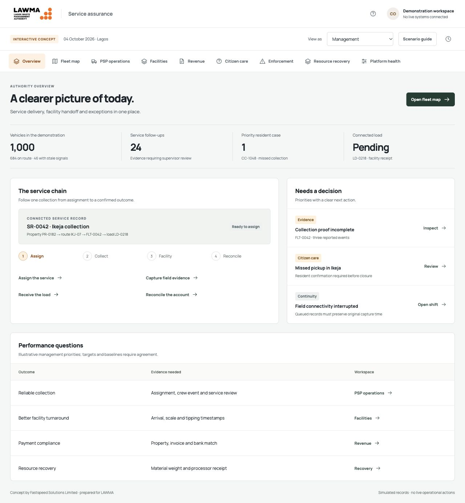

# LAWMA 360

Interactive service-assurance concept for the Lagos Waste Management Authority, prepared under **Fastspeed Solutions Limited** branding.

The prototype connects fleet visibility, PSP assignments, collection evidence, facility intake, revenue reconciliation, citizen care, enforcement review and resource recovery. It includes 11 persona entry points and 1,000 simulated vehicle records.

> This is a presentation prototype, not a production LAWMA system. All operational records are simulated. Role switching is a preview, not authentication. No money is moved, gates operated, messages sent or penalties issued.



## Run locally

Requirements: Python 3 and a current browser. Map tiles require internet access and WebGL. There is no Node/npm installation step.

```sh
git clone https://github.com/ismailquadri/LAWMA-360.git
cd LAWMA-360
python3 work/preview_server.py
```

Open **http://127.0.0.1:8765/**. Stop the server with Ctrl+C. The server binds only to localhost and serves only the compiled dashboard.

Alternatively, open `outputs/LAWMA_Service_Assurance_Dashboard.html` directly in a browser. A local HTTP preview is recommended for consistent map and browser-storage behavior.

## Rebuild after editing

Run from the repository root:

```sh
python3 work/build_dashboard.py
```

The builder embeds the HTML template, styles, JavaScript, route data, logo and vendored MapLibre into the standalone dashboard. Refresh the preview after rebuilding.

## Explore the demo

Use **View as** for a persona-specific entry point, or **Scenario guide** for a walkthrough:

1. **PSP dispatcher:** assign IKJ-07 to FLT-0042.
2. **Field crew:** capture the BIN-0182 event; simulate offline operation, restore connection and sync.
3. **Facility operator:** enter gross/tare weights and confirm unloading to create LD-0218.
4. **Revenue officer:** match the sample bank payment to INV-0182.
5. **Customer care:** assign recovery for CC-1048, then record resident confirmation.
6. **Resident:** inspect the updated case and payment status.

Journey progress is stored in session storage. **Reset demonstration** clears the sample journey. Fleet follow-up changes are held in memory and reset on reload.

## Appearance and motion

Choose **Light**, **Dark** or **System** in the header. The preference persists locally. Motion respects reduced-motion settings. The embedded map engine initializes on first fleet entry; this defers execution rather than reducing the standalone file size.

[Light preview](outputs/LAWMA_Light_Mode.jpg) · [Dark preview](outputs/LAWMA_Dark_Mode.jpg)

## Documentation

- [UX research process and case study](docs/CASE-STUDY-LAWMA-360.md)
- [Project documentation and technical handover](docs/PROJECT_DOCUMENTATION.md)
- [Persona journeys and requirement coverage](outputs/LAWMA_Prototype_Journeys_and_Coverage.md)
- [Project understanding and unresolved requirements](outputs/LAWMA_project_understanding_review.md)
- [Client point of view](outputs/Fast_Speed_Solutions_LAWMA_client_point_of_view.md)
- [Domain research report — PDF](outputs/Fast_Speed_Solutions_LAWMA_Domain_Research_Report.pdf)
- [Fleet design rationale](outputs/LAWMA_Dashboard_Design_Notes.md) — earlier fleet-focused iteration
- [Third-party assets and attribution](docs/THIRD_PARTY_NOTICES.md)

## Repository layout

```text
outputs/                  Shareable dashboard, reports, documents and screenshots
  dashboard-assets/       Vendored MapLibre 5.6.2 and license
work/                     Editable application sources, builders and route fixtures
docs/                     Project handover and third-party notices
archive/                  Historical scripts; not used by the current build
requirements-report.txt   Optional PDF-generation dependency
```

## Deployment

The compiled HTML is a static artifact. To deploy, copy it to a static host as `index.html`. It requires no backend, API key or build service. External map requests still go to the configured map provider. Repository upload does not deploy or enable GitHub Pages.

## Scope and limitations

Original proposal PDFs, architecture images and hardware workbook are not included because they were not present in the current workspace. The repository contains the consolidated assessment and available generated report. Nine road-aligned sample routes are reused across the synthetic fleet; these are not certified heavy-vehicle routes. Live integrations, backend authorization, production offline synchronization and policy approval remain future work.

No production readiness, accessibility certification or exhaustive test coverage is claimed. Review the handover document before extending or presenting the concept as an operational platform.
